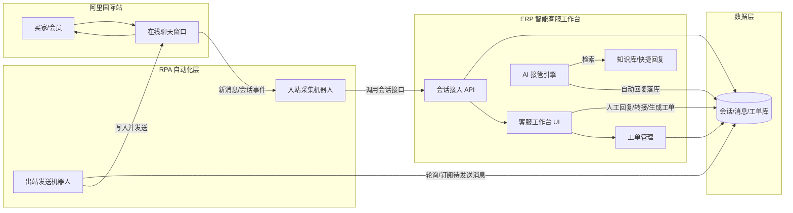
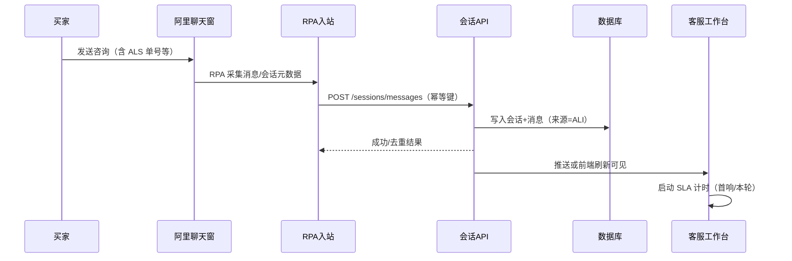
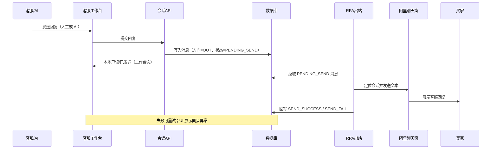
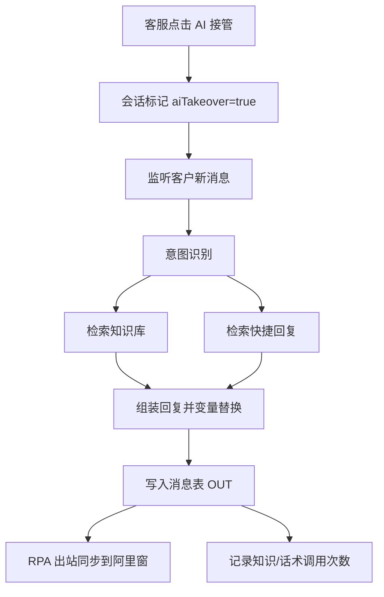
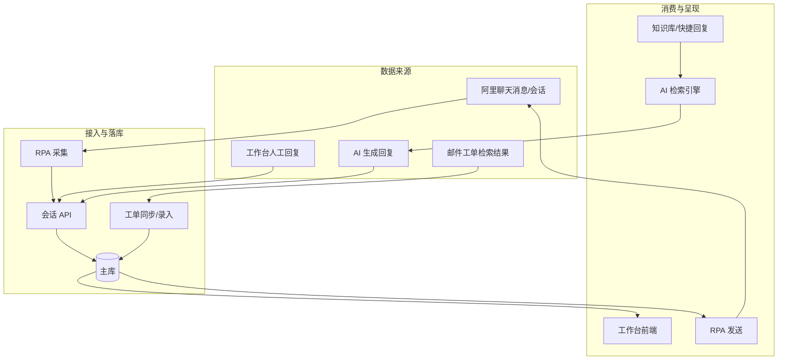
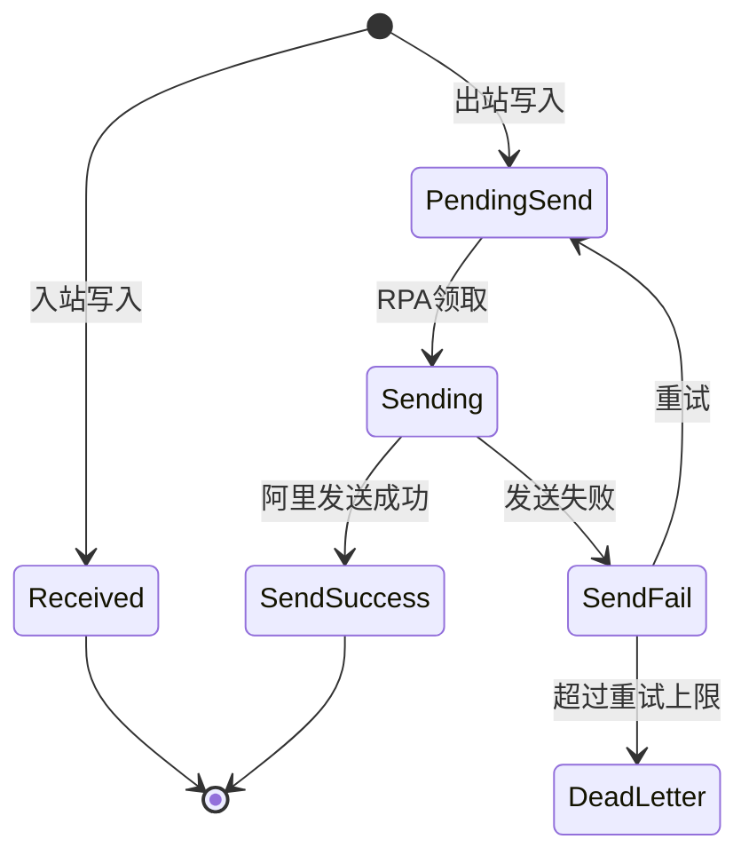

# 智能客服后台工作台 PRD


| 项    | 内容                              |
| ---- | ------------------------------- |
| 产品名称 | 智能客服后台工作台 PRO                   |
| 文档版本 | V1.0                            |
| 适用业务 | 跨境物流客服（阿里国际站 / ICBU 物流咨询 · 八达通） |
| 文档状态 | 初稿（基于当前前端原型 + RPA 桥接方案）         |
| 目标读者 | 产品、研发、测试、RPA、运营、客服主管            |


---

## 1. 背景与目标

### 1.1 问题背景

跨境物流客服大量会话发生在 **阿里国际站在线聊天窗口**。客服同时需要在 ERP/客服工作台完成：

- 查订单 / 尾程单号 / 面单 / 轨迹
- 使用知识库与快捷回复提效
- 受 SLA（首响、本轮）约束
- 处理邮件工单与异常升级

若客服在阿里窗口与 ERP 之间手工复制粘贴，存在：

- 回复慢、易漏、难质检
- 会话无统一落库，无法做历史回溯与 AI 接管
- 工单与会话割裂，无法形成闭环

这是当时的处理流程
1：RPA启动时，建立ERP连接通道
2：阿里会话进来时，RPA向ERP注册会话连接通道
3：RPA发送消息，ERP收到后返回消息接收成功
4：RPA接收ERP消息或操作事件，RPA返回接收事件成功，处理后，返回事件处理成功
5：RPA向ERP关闭会话连接通道事件
6：RPA关闭或奔溃，自动断开ERP连接通道，ERP在即使反馈哪个RPA已下线，若还有会话在线，要及时提示人工前往RPA所在电脑干预

### 1.2 产品目标

建设 **ERP 侧智能客服工作台**，并通过 **RPA** 与阿里国际站聊天双向同步：

1. **入站**：阿里客户消息 → RPA → 系统会话接口 → 工作台展示并落库
2. **出站**：客服/AI 在工作台回复 → 落库 → RPA 拉取 → 写入阿里聊天窗口发送
3. **提效**：快捷回复、知识库、AI 接管、SLA 计时、工单管理一体承载


### 1.3 成功标准（一期）


| 指标            | 目标（建议）        |
| ------------- | ------------- |
| 阿里消息入站到工作台可见  | P95 ≤ 5s      |
| 工作台发送到阿里窗口发出  | P95 ≤ 8s      |
| 会话消息落库完整率     | ≥ 99.5%       |
| 首响超时率（人工会话）   | 环比下降（基线上线后统计） |
| 双向同步失败可告警、可重试 | 100% 可追踪      |


### 1.4 非目标（一期不做）

- 直接对接阿里开放 IM API（当前以 RPA 为桥）
- 完整多租户权限与排班系统
- 替代邮件工单原平台（超级工单），本期做管理与协同视图

---


## 2. 用户与场景


### 2.1 角色


| 角色     | 诉求                                  |
| ------ | ----------------------------------- |
| 一线客服   | 在 ERP 工作台统一接待；快速查单、引用话术；满足首响/本轮 SLA |
| 客服主管   | 看工作台看板、超时会话、工单积压、AI 调用情况            |
| RPA 运维 | 明确同步接口、幂等、失败重试与对账字段                 |
| 产品/运营  | 知识库与快捷回复可持续运营，支撑 AI 接管              |


### 2.2 典型场景

1. **尾程查询**：客户问「ALS02010204573 尾程单号和面单」→ 工作台展示 → 客服/AI 回复 → RPA 发回阿里窗
2. **轨迹链接**：客户要「尾程单号 + 轨迹查询网址」→ 引用快捷回复/知识库 → 同步发送
3. **订单状态**：客户问「ALS02012985866 目前状态」→ 关联订单状态回复
4. **邮件工单**：阿里邮件进线形成工单 → 工单管理分配/完结（与会话可关联订单号）
5. **AI 接管**：客服开启 AI → 系统检索知识库 + 快捷回复自动生成回复 → 同样走落库与 RPA 出站

---


## 3. 业务流


### 3.1 端到端业务流（Happy Path）




### 3.2 入站业务流（阿里 → 工作台）




### 3.3 出站业务流（工作台 → 阿里）




### 3.4 AI 接管业务流




---


## 4. 数据流


### 4.1 数据流总览




### 4.2 核心数据对象（建议）


| 对象                     | 说明           | 关键字段（摘要）                                                                                                            |
| ---------------------- | ------------ | ------------------------------------------------------------------------------------------------------------------- |
| Session（会话）            | 一次买家-客服沟通上下文 | session_id, ali_chat_id, member_id, channel, status, sla_waiting_at, ai_takeover                                    |
| Message（消息）            | 单条消息         | message_id, session_id, direction(IN/OUT), content, sender_type(buyer/agent/ai/system), sync_status, idempotent_key |
| OrderRef（关联单）          | ALS 物流订单引用   | order_no, last_mile_no, courier, track_url, status                                                                  |
| Ticket（工单）             | 邮件/升级工单      | case_id, task_status, case_status, email_title, from_email, order_no, servicer                                      |
| Knowledge / QuickReply | 知识与话术        | category, tags, keywords, content, use_count                                                                        |


### 4.3 消息同步状态机




### 4.4 关键接口约定（供 RPA / 后端）

> 以下为产品级接口契约，具体路径以研发实现为准。

**1）入站：同步客户消息**

- `POST /api/cs/sessions/inbound`
- 幂等键：`ali_chat_id + ali_msg_id`
- 关键载荷：会员、聊天窗 ID、消息文本、时间、渠道、可选订单号抽取结果

**2）出站：拉取待发送**

- `GET /api/cs/messages/outbound?status=PENDING_SEND&limit=50`
- 返回：message_id、ali_chat_id、content、priority

**3）出站回写**

- `POST /api/cs/messages/{id}/sync-result`
- body：`SUCCESS | FAIL`、错误码、阿里侧回执时间

**4）会话心跳 / 在线状态（可选）**

- 客服在线状态变更，供分配与 SLA 统计

---


## 5. 系统边界


| 系统          | 职责                     | 非职责          |
| ----------- | ---------------------- | ------------ |
| 阿里国际站聊天     | 买家触点 UI                | 不作为会话主库      |
| RPA         | UI 自动化采集与发送；调用 ERP API | 不承载业务规则/知识库  |
| ERP 客服工作台   | 接待、SLA、AI、知识/话术、工单视图   | 不直接操控阿里 DOM  |
| ERP/OMS 订单域 | 提供 ALS 订单、尾程、轨迹真相      | 不负责 IM 同步    |
| 超级工单（阿里侧）   | 原邮件工单生产系统              | 本期以同步/管理视图为主 |


**原则**：会话与消息的 **Source of Truth 在 ERP 数据库**；阿里窗口是触达通道；RPA 是适配器。

---


## 6. 功能范围（对齐当前产品）


### 6.1 模块地图


| 模块      | 能力摘要                                | 优先级 |
| ------- | ----------------------------------- | --- |
| 工作台首页   | KPI、优先接待、待办工单、热门话术/知识               | P0  |
| 在线会话    | 三栏接待、SLA 计时、转接、AI 接管、查订单/轨迹工具、Emoji | P0  |
| 历史会话    | 按日期/状态/关键词查询、详情回看                   | P0  |
| 快捷回复    | 分类、标签、使用次数、在线侧栏检索引用                 | P0  |
| 知识库     | 跨境物流知识、关键词、AI 调用计数                  | P0  |
| 工单管理    | 对齐超级工单字段：列表筛选、旗帜、分配、完结              | P0  |
| RPA 同步  | 入站/出站/回写/对账（后端+RPA）                 | P0  |
| 知识库门户站点 | FAQ 外发（可后续）                         | P2  |


### 6.2 在线会话关键规则


| 规则     | 说明                        |
| ------ | ------------------------- |
| 首响 SLA | 客户进线后首次人工回复 ≤ 20 秒        |
| 本轮 SLA | 已回复过的会话，客户再发后本轮 ≤ 2 分钟    |
| AI 接管  | 开启后暂停人工输入；自动检索知识库+快捷回复并出站 |
| 工具栏    | 查订单、查轨迹、插入单号变量等           |
| 不展示    | 在线聊天不展示 VIP1/VIP2 等会员等级标签 |


### 6.3 AI 接管检索策略（当前实现）

1. 识别意图：尾程单号 / 订单状态 / 清关 / 费用 / FBA / 异常等
2. 打分检索知识库（标题+正文+keywords）与快捷回复（标题+内容+tags）
3. 解析 ALS 单号，填充 `{订单号}{运单号}{快递公司}{轨迹网址}`
4. 落库 OUT 消息，供 RPA 发送；累计 use_count

---


## 7. 页面与信息架构

```text
默认入口：/workbench 工作台
├── 在线会话 /chat
├── 历史会话 /history
├── 快捷回复 /quick-reply
├── 知识库管理 /knowledge
└── 工单管理 /tickets
```

工作台首页聚合：进行中会话、SLA 超时、待办工单、AI 接管数、优先接待列表、热门话术/知识。

---


## 8. 非功能需求


| 类别  | 要求                             |
| --- | ------------------------------ |
| 可靠性 | 入站/出站幂等；失败可重试；死信可人工介入          |
| 安全  | RPA 账号权限最小化；接口鉴权；脱敏展示邮箱/电话     |
| 审计  | 每条 OUT 记录发送人（人工/AI）、引用知识/话术 ID |
| 可观测 | 同步延迟、失败率、重试次数、SLA 超时看板         |
| 性能  | 会话列表与消息流分页；工作台首屏可接受 2s 内       |


---


## 9. 埋点与运营指标


| 事件                              | 用途               |
| ------------------------------- | ---------------- |
| session_inbound                 | 入站量、渠道分布         |
| message_outbound_sync           | 出站成功率、延迟         |
| sla_first_reply / sla_round     | 超时率              |
| ai_takeover_reply               | AI 占比、意图分布、知识命中率 |
| quick_reply_use / knowledge_use | 话术与知识运营          |


---


## 10. 风险与对策


| 风险             | 影响      | 对策                         |
| -------------- | ------- | -------------------------- |
| RPA 页面改版导致采集失败 | 双向中断    | 元素定位兜底、心跳告警、人工应急通道         |
| 双写乱序（先出站后入站）   | 会话错乱    | 以阿里 msg_id + 本地时间序校正；服务端排序 |
| AI 误答物流状态      | 客诉      | 强依赖订单接口真相；不确定则转人工          |
| 发送失败未感知        | 客户以为未回复 | UI 明确 sync_status；失败高亮重试   |
| 工单与会话订单号不一致    | 处理断点    | 统一 ALS 抽取规则与关联表            |


---


## 11. 验收标准（节选）

**Given** 阿里窗买家发送含 ALS 单号的消息  
**When** RPA 成功调用入站接口  
**Then** 工作台对应会话在 5s 内可见该消息，并开始 SLA 计时，消息已落库且幂等键可去重  

**Given** 客服在工作台发送一条回复  
**When** RPA 拉取到 PENDING_SEND 并发送成功  
**Then** 阿里窗买家可见同文案，库中状态为 SEND_SUCCESS，工作台无失败提示  

**Given** 会话开启 AI 接管且客户询问尾程单号  
**When** AI 完成检索  
**Then** 生成含尾程单号/轨迹网址的回复并落库出站；知识库或快捷回复 use_count +1  

**Given** 工单列表存在待分配任务  
**When** 客服执行分配  
**Then** 任务状态变为处理中并记录处理人（Mock/正式环境字段一致）

---


## 12. 里程碑建议


| 阶段        | 交付                                |
| --------- | --------------------------------- |
| M1 原型已完成  | 工作台前端：会话/历史/话术/知识/工单/AI/SLA（当前仓库） |
| M2 会话中台   | 会话/消息表、入站出站 API、幂等与状态机            |
| M3 RPA 联调 | 阿里窗入站采集 + 出站发送 + 失败重试 + 监控        |
| M4 订单联动   | 对接 ERP 订单查询（尾程/面单/轨迹 URL 真源）      |
| M5 运营优化   | AI 命中率、话术运营、质检抽样                  |


---


## 13. 假设与待确认

1. 一期 **仅阿里国际站在线聊天 + 邮件工单**；其他渠道可复用会话模型后扩展。
2. RPA 与 ERP 同网或经专线；接口鉴权方式（Token/签名）待基建确认。
3. 面单 PDF 是否由 OMS 生成、客服工作台仅拿链接，待订单域确认。
4. AI 是否必须调用大模型 API，或一期继续「检索拼装」方案上线，二期再接 LLM。

---


## 附录 A：与当前前端模块对应


| PRD 模块      | 代码位置（参考）                                                  |
| ----------- | --------------------------------------------------------- |
| 工作台         | `src/views/WorkbenchHome.vue`                             |
| 在线会话        | `src/views/ChatWorkbench.vue` + `components/chat/*`       |
| 历史会话        | `src/views/HistorySessions.vue`                           |
| 快捷回复        | `src/views/QuickReplyManage.vue` + `stores/quickReply.ts` |
| 知识库 / AI 检索 | `src/views/KnowledgeManage.vue` + `utils/aiRetrieve.ts`   |
| 工单管理        | `src/views/TicketManage.vue` + `mock/tickets.ts`          |
| SLA         | `utils/sla.ts` + `components/chat/SlaTimer.vue`           |


---


## 附录 B：业务一句话总结

> **阿里国际站是触点，RPA 是桥，ERP 客服工作台是作业与智能中枢，数据库是会话真相源：客户消息自动进工作台，客服/AI 回复自动回写阿里窗。**

