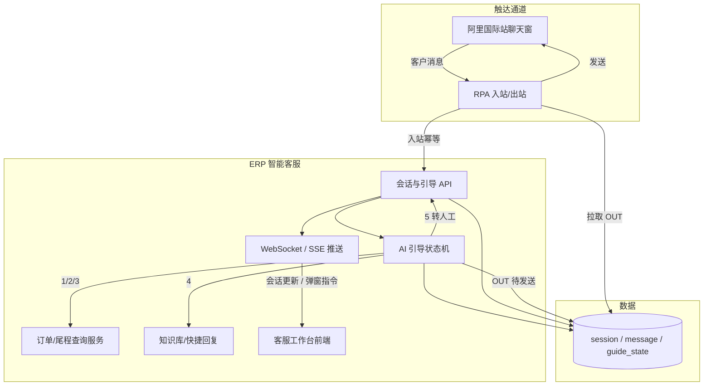
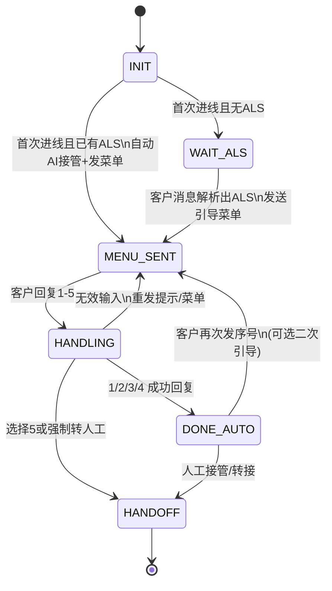
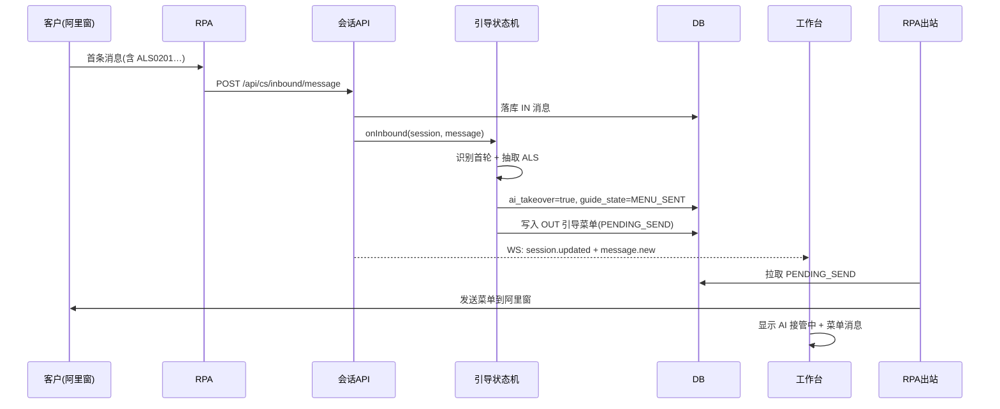
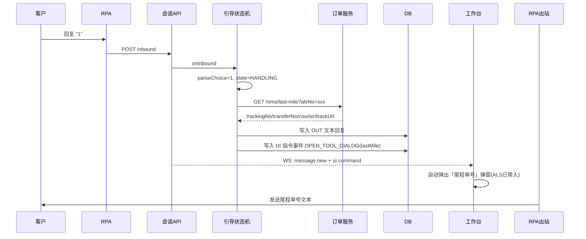

# 首次进线 AI 自动接管 · 序号引导与业务接口路由 — 落地方案

| 项 | 内容 |
| --- | --- |
| 文档版本 | V1.0 |
| 关联产品 | 智能客服后台工作台 PRO |
| 关联 PRD | `docs/PRD-智能客服工作台.md` |
| 前端原型现状 | 已有引导菜单文案、序号解析、尾程弹窗；待对接真实后台 |
| 目标读者 | 产品、前端、后端、RPA、测试 |


---

## 1. 目标与范围

### 1.1 业务目标

客户**首次进入会话**时系统自动开启 **AI 接管**，并按以下闭环运行：

1. 识别 / 绑定客户提供的 **ALS 单号**
2. 自动发送**意图引导菜单**（问题序号 1–5）
3. 客户回复序号后，按序号**路由到不同业务接口**，组装回复并经 RPA 回写阿里窗
4. 对需要客服侧操作的场景（如尾程单号 / 面单），工作台**自动弹出对应查询弹窗**，方便人工复核与引用

### 1.2 引导菜单（固定话术）

```text
您好，您提供的 {ALS单号} 单号，是想要查询以下什么问题呢，请回复对应问题序号
1.是否需要尾程单号
2.是否需要尾程面单
3.是否需要尾程物流联系方式
4.咨询承运类，产品是否能承运、运费问题等
5.其他-转人工客服
```

### 1.3 序号路由一览


| 客户回复 | 业务意图 | 后台动作 | 工作台表现 | 出站回复 |
| --- | --- | --- | --- | --- |
| `1` | 尾程单号 | 调 OMS「尾程单号查询」 | **自动弹出「尾程单号」弹窗**，可引用追踪号/转运号 | 文本回复单号信息 |
| `2` | 尾程面单 | 调 OMS「面单/标签」 | **自动弹出「尾程面单」弹窗**（图片预览） | 文本说明 + 可选面单链接 |
| `3` | 尾程物流联系方式 | 调 OMS「承运商联系方式」 | 可选弹出轨迹/订单页 | 文本回复联系方式 |
| `4` | 承运/运费咨询 | 转「承运咨询」技能 / 知识库检索 | 保持 AI 或多轮追问 | 引导补充品名/尺寸/线路 |
| `5` | 转人工 | 关闭 AI 接管，分配/提醒人工 | SLA 恢复人工首响/本轮 | 告知已转人工 |


### 1.4 非目标（本期不做）

- 直接对接阿里开放 IM API（仍走 RPA）
- 复杂多轮 NLP 自由对话替代序号菜单（菜单优先，自由文本可二期）
- 面单文件真源存储改造（先拿 OMS 已有链接/图片 URL）


---

## 2. 总体架构



**核心原则**

- **真相在后台**：引导状态、AI 接管开关、序号路由、业务查询均由后端完成。
- **前端只渲染 + 执行指令**：展示消息；收到 `OPEN_TOOL_DIALOG` 时弹出对应工具窗。
- **出站统一走消息表**：AI 回复与人工回复同一条出站链路（RPA）。


---

## 3. 状态机设计（会话引导）

### 3.1 状态定义


| 状态 | 含义 |
| --- | --- |
| `INIT` | 会话新建，尚未完成引导 |
| `WAIT_ALS` | 已 AI 接管，但未识别到 ALS，等待客户补单号 |
| `MENU_SENT` | 已发送引导菜单，等待客户回复 1–5 |
| `HANDLING` | 正在调用业务接口 / 生成回复 |
| `DONE_AUTO` | 本轮自动处理完成，可继续菜单或结束 AI |
| `HANDOFF` | 已转人工，AI 接管关闭 |


### 3.2 状态流转




### 3.3 会话扩展字段（建议）

```text
session.ai_takeover          BOOLEAN   -- 是否 AI 接管
session.guide_state          ENUM      -- 上表状态
session.guided_als_no        VARCHAR   -- 引导绑定的 ALS
session.intent_menu_sent_at  DATETIME  -- 菜单发送时间
session.last_intent_choice   TINYINT   -- 最近一次有效序号
session.guide_version        VARCHAR   -- 菜单话术版本号，便于运营改文案
```


---

## 4. 端到端时序

### 4.1 首次进线（自动 AI + 发菜单）




### 4.2 客户回复「1」：查尾程单号 + 弹窗




---

## 5. 后台设计

### 5.1 模块划分


| 模块 | 职责 |
| --- | --- |
| `InboundController` | RPA 入站鉴权、幂等、落库 |
| `GuideEngine` | 状态机、ALS 抽取、序号解析、路由 |
| `IntentRouter` | choice → 具体 Handler |
| `LastMileHandler` / `LabelHandler` / `ContactHandler` | 调 OMS，组装回复 + UI 指令 |
| `CarrierConsultHandler` | 知识库/规则追问 |
| `HandoffHandler` | 关 AI、转队列、通知坐席 |
| `OutboundPublisher` | 写 OUT 消息供 RPA |
| `RealtimeGateway` | WebSocket/SSE 推前端 |


### 5.2 推荐接口

#### （1）RPA 入站（已有可扩展）

`POST /api/cs/inbound/message`

```json
{
  "idempotencyKey": "ali-msg-xxx",
  "externalSessionId": "ali-session-xxx",
  "customerName": "禹逸飞",
  "content": "帮忙查 ALS02010204573",
  "channel": "ICBU",
  "occurredAt": "2026-11-03T10:00:00+08:00"
}
```

处理要点：

1. 幂等去重  
2. 绑定/创建内部 `sessionId`  
3. **若会话首次有效客户消息**：`ai_takeover=true`  
4. 调用 `GuideEngine.onInbound`

#### （2）业务查询（供引导引擎与工作台弹窗共用）

| 方法 | 路径 | 用途 |
| --- | --- | --- |
| GET | `/api/oms/orders/{alsNo}/last-mile` | 追踪单号、转运单号、承运商、轨迹 URL |
| GET | `/api/oms/orders/{alsNo}/label` | 尾程面单图片/PDF URL |
| GET | `/api/oms/orders/{alsNo}/pod` | 签收凭证 |
| GET | `/api/oms/orders/{alsNo}/contact` | 尾程物流联系方式 |
| GET | `/api/oms/orders/{alsNo}/tracks` | 轨迹表格 |
| GET | `/api/oms/orders/{alsNo}/logs` | 订单操作日志 |
| POST | `/api/oms/orders/{alsNo}/logs` | 人工补录日志 |

**`GET .../last-mile` 响应示例**

```json
{
  "alsNo": "ALS02010204573",
  "courier": "UPS",
  "trackingNo": "1Z999AA10123456784",
  "transferNo": "TRF-SZ-884210",
  "status": "尾程派送中",
  "trackUrl": "https://www.17track.net/zh-cn#nums=1Z999AA10123456784"
}
```

#### （3）工作台主动查询（弹窗内点「查询」）

与上表同一套 OMS API，前端弹窗不重复造业务逻辑。

#### （4）实时推送事件（WS）

```json
{
  "type": "ui.command",
  "sessionId": "s2",
  "command": "OPEN_TOOL_DIALOG",
  "payload": {
    "tool": "lastMile",
    "alsNo": "ALS02010204573",
    "prefetch": true
  }
}
```

`tool` 枚举：`lastMile` | `label` | `pod` | `track` | `logs`


### 5.3 IntentRouter 伪代码

```text
onInbound(session, message):
  if not session.ai_takeover and isFirstCustomerRound(session):
      session.ai_takeover = true

  als = extractAls(message.content) or session.guided_als_no

  if session.guide_state in (INIT, WAIT_ALS):
      if not als:
          reply("请提供 ALS 订单号，例如 ALS02010204573")
          session.guide_state = WAIT_ALS
          return
      session.guided_als_no = als
      reply(buildIntentMenu(als))
      session.guide_state = MENU_SENT
      return

  if session.guide_state == MENU_SENT:
      choice = parseIntentChoice(message.content)
      if choice is null:
          reply("请回复问题序号 1-5，例如直接回复：1")
          return
      session.guide_state = HANDLING
      dispatch(choice, session)
      return

  # DONE_AUTO 后：若再收到纯序号，可再次 dispatch；否则走通用 AI/人工
```

```text
dispatch(choice, session):
  switch choice:
    1 -> data = oms.lastMile(als)
         outbound(textFrom(data))
         pushUi(OPEN_TOOL_DIALOG, lastMile, als)
    2 -> data = oms.label(als)
         outbound(textOrLink(data))
         pushUi(OPEN_TOOL_DIALOG, label, als)
    3 -> data = oms.contact(als)
         outbound(contactText(data))
    4 -> outbound(carrierAskMore())
         // 可进入子状态 CARRIER_QA
    5 -> handoffToHuman(session)
  session.last_intent_choice = choice
  session.guide_state = (choice==5 ? HANDOFF : DONE_AUTO)
```


### 5.4 出站消息模型（建议字段）

```text
message.id
message.session_id
message.direction          IN / OUT
message.sender_type        CUSTOMER / AGENT / AI_GUIDE / SYSTEM
message.content
message.content_type       TEXT / IMAGE_URL / CARD
message.send_status        PENDING_SEND / SENT / FAIL
message.related_intent     1..5 nullable
message.idempotency_key
```


### 5.5 幂等与失败

- 入站：`idempotencyKey` 唯一；重复投递直接返回成功。  
- 业务查询失败：回复「暂未查到，已通知人工」+ `guide_state=HANDOFF` 或保持 `MENU_SENT` 允许重选。  
- 出站失败：RPA 重试；工作台展示同步异常标。  
- 弹窗指令：前端可丢，不影响客户侧文本已发送（指令仅增强坐席体验）。


---

## 6. 前端设计

### 6.1 职责边界


| 能力 | 前端 | 后端 |
| --- | --- | --- |
| 是否首次进线 / AI 自动开 | 只读展示 | ✅ 判定并落库 |
| 发引导菜单 | 展示消息 | ✅ 生成 OUT |
| 解析 1–5 | 可做本地预览，不作为真相 | ✅ 权威解析 |
| 调 OMS 查单 | 弹窗内查询走同一 API | ✅ 提供 API |
| 自动弹窗 | ✅ 消费 `ui.command` | ✅ 下发指令 |
| RPA 出站 | 不参与 | ✅ + RPA |


> 当前原型里「前端本地模拟引导」仅用于演示；正式环境应改为**以后台事件为准**，避免双端各发一遍菜单。


### 6.2 页面与组件映射（基于现有代码）


| 现有 | 改造点 |
| --- | --- |
| `stores/session.ts` | `aiTakeover` / `guideState` 改为接口回写；去掉「本地伪造菜单」作为主路径，改为 WS 驱动 |
| `utils/intentGuide.ts` | 保留文案与解析，供前端兜底展示；正式解析以后端为准 |
| `OrderQueryDialog.vue` | 弹窗查询改调 `/api/oms/orders/{alsNo}/*`；支持 `prefetch` 自动查询 |
| `ChatComposer.vue` | 监听 `pendingOrderTool` / WS `OPEN_TOOL_DIALOG` 打开弹窗 |
| `ChatHeader.vue` | AI 接管角标：首次进线显示「AI 引导中」；转人工后可点取消/接管 |


### 6.3 前端事件处理伪代码

```ts
// realtime.ts
socket.on('ui.command', (evt) => {
  if (evt.command === 'OPEN_TOOL_DIALOG') {
    sessionStore.setPendingOrderTool({
      type: evt.payload.tool, // lastMile | label | ...
      alsNo: evt.payload.alsNo,
      prefetch: evt.payload.prefetch ?? true,
    })
  }
})

// ChatComposer.vue
watch(pendingOrderTool, (p) => {
  if (!p) return
  rememberAls(p.alsNo)
  openDialog(p.type) // 打开 OrderQueryDialog
  clearPending()
})
```


### 6.4 交互细节

1. **AI 接管中**：输入框禁用（现有逻辑可复用），避免与引导冲突。  
2. **回复 1 弹窗**：即使客服不在当前会话，也应在会话上挂起 `pendingCommand`；客服切入该会话时补弹一次。  
3. **弹窗与出站并行**：客户已在阿里窗看到文本；弹窗给坐席核对/引用，不阻塞出站。  
4. **转人工（5）**：前端收到 `ai_takeover=false` 后恢复输入，并提示「请尽快首响」。


---

## 7. 「推送接口」怎么落地（对应你说的 1/2/3）

建议拆成**两类接口**，不要混成一个大杂烩：

### 7.1 路由入口（会话域）

客户每条消息只进：

`POST /api/cs/inbound/message`  
→ 内部 `IntentRouter` 按 1/2/3 分发。

前端/坐席**不要**自己根据「1」去调三个业务接口拼回复（易漏出站、双发）。

### 7.2 业务查询（订单域，可被路由与弹窗复用）

```text
choice=1 → GET /api/oms/orders/{als}/last-mile
choice=2 → GET /api/oms/orders/{als}/label
choice=3 → GET /api/oms/orders/{als}/contact
```

若希望「一个推送接口」，也可提供聚合：

`POST /api/cs/guide/dispatch`

```json
{
  "sessionId": "s2",
  "alsNo": "ALS02010204573",
  "choice": 1
}
```

返回：

```json
{
  "replyText": "已为您查询到…追踪单号…",
  "uiCommand": { "command": "OPEN_TOOL_DIALOG", "tool": "lastMile", "alsNo": "ALS02010204573" },
  "outboundMessageId": "msg_xxx"
}
```

> 注意：线上主路径仍应由**入站消息自动触发 dispatch**；该聚合接口可用于联调、重试、或坐席「代客选序号」。


---

## 8. 与现有原型的对齐

当前前端已具备：

- 引导菜单文案与序号解析（`intentGuide.ts`）
- 回复 1 自动打开尾程弹窗（`pendingOrderTool`）
- 订单工具弹窗（尾程/面单/轨迹/POD/日志）

落地时建议分两步替换：

1. **Phase A**：后台实现状态机 + OMS 查询；前端弹窗改真实 API；入站仍可 Mock。  
2. **Phase B**：接通 RPA 入站/出站；删除前端「本地自动发菜单」主逻辑，改为纯展示后台结果。  
3. **Phase C**：补监控、话术配置化、承运咨询多轮（序号 4）。


---

## 9. 数据与配置

### 9.1 话术配置化（建议）

菜单不要写死在代码里，放到运营配置：

```text
guide_script.version = v1
guide_script.menu_template = "您好，您提供的 {alsNo} 单号…"
guide_script.options = [1..5]
```

便于改文案不发版。

### 9.2 审计字段

每次自动回复记录：

- `intent_choice`
- `als_no`
- `oms_latency_ms`
- `oms_success`
- `outbound_message_id`
- `ui_command_sent`


---

## 10. 测试用例（验收）


| 编号 | 场景 | 期望 |
| --- | --- | --- |
| T1 | 首条消息含 ALS | 自动 AI 接管 + 发出菜单；状态 `MENU_SENT` |
| T2 | 首条无 ALS | 追问 ALS；状态 `WAIT_ALS` |
| T3 | 菜单后回 `1` | OUT 含追踪/转运单号；工作台弹尾程窗 |
| T4 | 菜单后回 `2` | OUT 含面单说明/链接；弹面单窗 |
| T5 | 菜单后回 `3` | OUT 含物流联系方式 |
| T6 | 回 `4` | 追问品名/尺寸/线路，不关 AI |
| T7 | 回 `5` | AI 关闭，转人工，可输入 |
| T8 | 回 `9` / 乱码 | 提示重选 1–5，不调 OMS |
| T9 | OMS 超时 | 友好失败文案 + 可转人工 |
| T10 | 入站重复投递 | 不重复发菜单 |
| T11 | 客服不在该会话时回 `1` | 切入会话后补弹窗或指令可消费 |


---

## 11. 排期建议（可落地）


| 阶段 | 周期 | 交付 |
| --- | --- | --- |
| M1 | 3–5 天 | 状态机 + 菜单发送 + 序号解析 + Mock OMS |
| M2 | 3–5 天 | 真实 last-mile / label / contact 接口；前端弹窗接 API |
| M3 | 3–5 天 | WS 指令 `OPEN_TOOL_DIALOG`；与 RPA 出站联调 |
| M4 | 2–3 天 | 转人工、失败重试、监控埋点、验收用例 |


---

## 12. 结论（实现思路一句话）

**后台用「引导状态机 + 序号路由器」在入站时自动 AI 接管并调用 OMS；前端只订阅消息与 `OPEN_TOOL_DIALOG` 指令做展示和弹窗；出站统一落库由 RPA 发到阿里窗。**  
这样 1/2/3 的差异收敛在后台 Handler，前端不分裂业务，也避免双端各回一次消息。


---

## 附录 A · 与 PRD 的关系

- 延续 PRD「RPA 桥接 + 会话落库 + AI 接管出站」主链路。  
- 将「客服手动开 AI」扩展为「**首次进线默认可自动开 AI 引导**」，转人工（序号 5）后回到人工 SLA。  
- 订单真源仍归 OMS；客服工作台与引导引擎只消费查询 API。


## 附录 B · 前端本地演示如何对照正式方案

| 原型行为 | 正式行为 |
| --- | --- |
| `afterCustomerMessage` 本地发菜单 | 删除或降级；改由入站 API 驱动 |
| `pendingOrderTool` 本地赋值 | 改为 WS `ui.command` 触发 |
| `queryLogisticsOrder` Mock | 换真实 `/api/oms/orders/{als}/*` |
| 「模拟客户互动」回 `1` | 联调期保留；上线可改为测试账号工具 |
